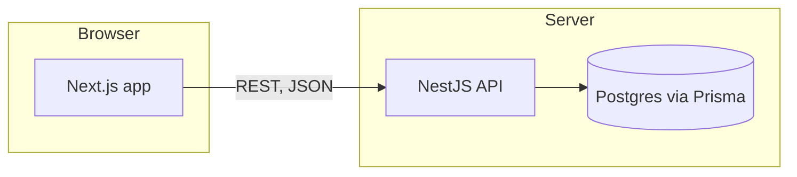
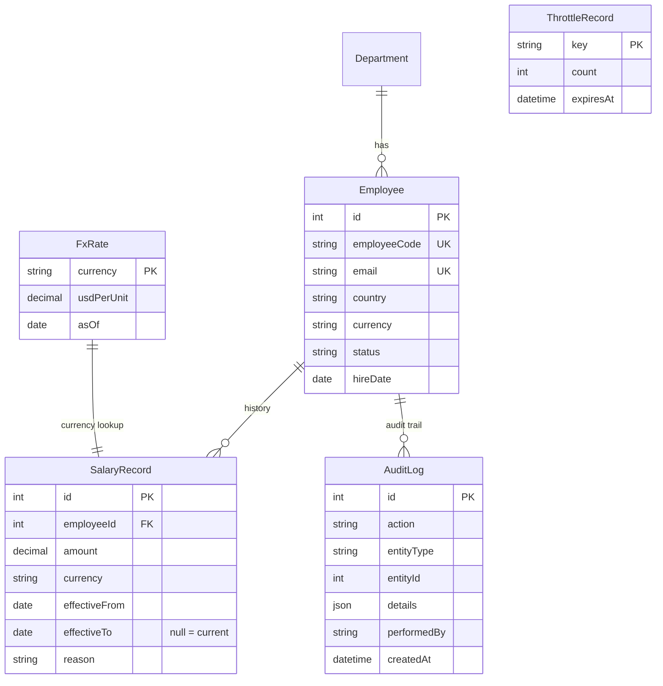

# Architecture

## Shape

Two deployable units in one npm-workspaces monorepo:

- `server/` - NestJS (Node + TypeScript) REST API. Prisma ORM over
  PostgreSQL (local Docker in dev, Neon in the hosted demo).
  Modules: `auth` (JWT sign-in, global guard), `employees` (directory,
  profiles, salary changes, CSV export), `analytics` (pay questions),
  `audit` (change log), `meta` (filter options), `prisma` (shared client).
- `web/` - Next.js (React + TypeScript) UI. The dashboard and employee pages
  are server rendered and fetch from the API; interactive pieces (charts,
  filters, forms) are client components. Tailwind for styling, Recharts for
  charts.

## Data model

The key decision: **salary is an append-only timeline**. A change closes the
open record (`effectiveTo`) and inserts a new open record, in one transaction.
History can never be overwritten, which is what makes audit questions ("what
did we pay this person last March?") answerable and what makes the timeline
safe against partial failures.

**AuditLog** records every mutation to employees and salary records: who did
it (`performedBy`, the JWT email), what changed (`details` JSON), and when.
It is indexed on `[entityId, entityType]` for per-employee queries and on
`[createdAt]` for the timeline view.

**ThrottleRecord** backs the Postgres-based rate limiter. Storing counters in
Postgres (rather than memory) means limits hold across serverless function
instances. The login route is capped at 10 req/min; all other routes at
300 req/min.

## Request flow example 1: record a raise

1. `POST /employees/:id/salary-changes` hits NestJS; the global guard checks
   the Bearer JWT before any handler runs.
2. `CreateSalaryChangeDto` validates shape, ranges and enums (class-validator,
   global ValidationPipe with `whitelist: true` strips unknown fields).
3. `EmployeesService.addSalaryChange` loads the open salary record, rejects
   dates that would rewrite the past, then closes the old record and inserts
   the new one inside `prisma.$transaction`.
4. Fire-and-forget audit: `audit.log({ action: 'SALARY_CHANGED', … }).catch(() => undefined)`.
5. The UI re-fetches the employee and the history table shows the new row.

## Request flow example 2: audit log write

Every mutating employees route threads `req.user.email` from the JWT all the
way to the database:

1. `JwtAuthGuard` validates the Bearer token and attaches the decoded payload
   (`email`, `sub`) to `req.user`.
2. The controller method extracts `req.user?.email ?? 'unknown'` and passes it
   as `performedBy` to the service method.
3. The service completes its main Prisma write (create / update / salary change).
4. It then calls `this.audit.log({ action, entityType, entityId, details, performedBy })`.
   This call is **fire-and-forget**: `.catch(() => undefined)` swallows any
   audit write error. The employee mutation has already committed; audit
   failure must never roll it back or surface a 500 to the client.
5. `AuditService.log()` calls `prisma.auditLog.create()`. The entry lands in
   the `AuditLog` table with a server-side `createdAt`.
6. `GET /audit` returns entries ordered by `createdAt desc`; the web UI renders
   them as a timeline with human-readable labels, relative timestamps, and a
   performer pill showing the email.

## Security posture

Salary data is sensitive, so the default is closed: a global auth guard
requires a JWT on every route except `/health` and `/auth/login`.

- Sign in: one HR Manager account, email + password. Passwords are stored as
  bcrypt hashes; the seed creates the account from `HR_EMAIL` / `HR_PASSWORD`
  environment variables, so a real deployment sets its own credentials and
  nothing secret is committed.
- Sessions: JWT signed with `JWT_SECRET` from env, 12 hour expiry. The UI
  keeps the token in localStorage and sends it as a Bearer header.
- Login errors use one generic message and run a dummy bcrypt comparison for
  unknown emails, so responses do not reveal which accounts exist.
- Mutations are validated DTOs (`whitelist: true` strips unknown fields), and
  the salary change runs in a transaction with a conditional close so two
  simultaneous raises cannot both win (see the race test).
- All database access is parameterized (Prisma, or static SQL for analytics).
- helmet security headers, 300 req/min global rate limiting with a stricter
  10 req/min limit on login, CORS restricted to the web origin. Rate limit
  counters live in Postgres (ThrottleRecord table), so the limits hold
  across every running instance, including serverless function instances.
- JWTs are signed with JWT_SECRET; the API refuses to boot in production
  without it, so a deployment can never silently use the public dev default.
- Deliberately not built: SSO, multiple roles, row level permissions. One
  persona means one role; see docs/requirements.md.
- Shared demo identity: every reviewer signs in as the same account and can
  mutate the same dataset with no per-person attribution. That is a demo
  limitation, not a security model; the README covers it and the reseed
  path for restoring a clean dataset.

## Testing

- `src/common/money.spec.ts` - FX conversion, median, bucket math.
- `src/seeding/generator.spec.ts` - dataset determinism and invariants
  (exactly one open salary record per employee, ordered history).
- `src/employees/employees.service.spec.ts` - integration tests against a
  freshly dropped Postgres schema: pagination, search, filters, employee
  creation, and the salary-change transaction (history preserved, single
  open record).

All tests are deterministic: the dataset comes from a seeded PRNG and each
suite gets its own freshly dropped schema in a shared local Postgres
(docker compose up -d test-db), so runs are fast and repeatable.
