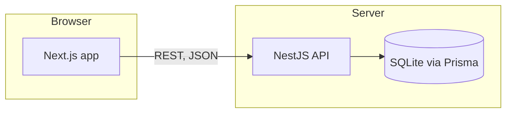
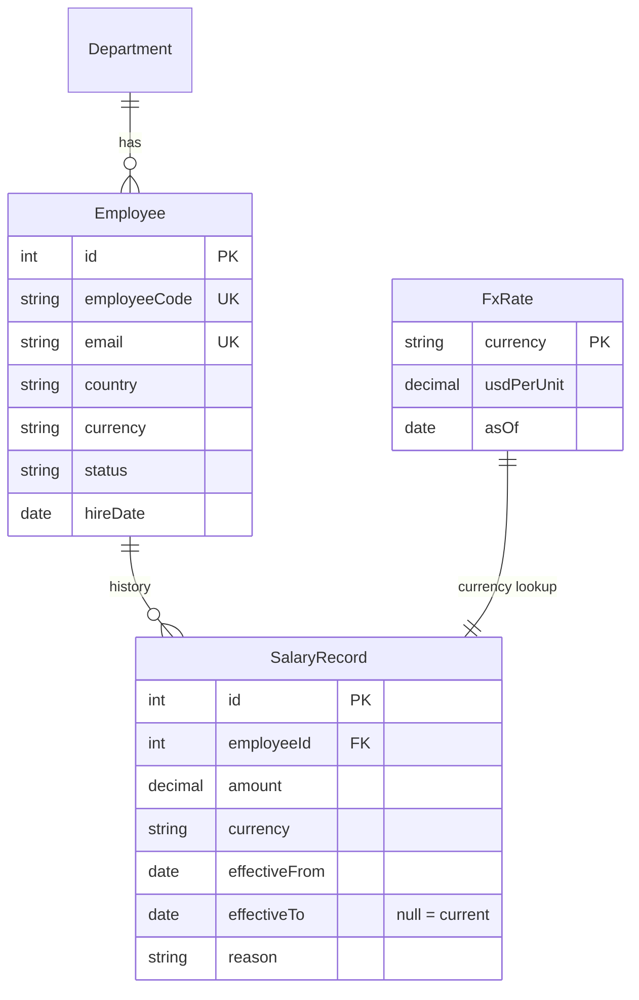

# Architecture

## Shape

Two deployable units in one npm-workspaces monorepo:

- `server/` - NestJS (Node + TypeScript) REST API. Prisma ORM over SQLite.
  Modules: `employees` (directory, profiles, salary changes), `analytics`
  (pay questions), `meta` (filter options), `prisma` (shared client).
- `web/` - Next.js (React + TypeScript) UI. The dashboard and employee pages
  are server rendered and fetch from the API; interactive pieces (charts,
  filters, forms) are client components. Tailwind for styling, Recharts for
  charts.

## Data model

The key decision: **salary is an append-only timeline**. A change closes the
open record (`effectiveTo`) and inserts a new open record, in one transaction.
History can never be overwritten, which is what makes audit questions ("what
did we pay this person last March?") answerable and what makes the timeline
safe against partial failures.

## Request flow example: record a raise

1. `POST /employees/:id/salary-changes` hits NestJS.
2. `CreateSalaryChangeDto` validates shape, ranges and enums (class-validator,
   global ValidationPipe with `whitelist: true` strips unknown fields).
3. `EmployeesService.addSalaryChange` loads the open salary record, rejects
   dates that would rewrite the past, then closes the old record and inserts
   the new one inside `prisma.$transaction`.
4. The UI re-fetches the employee and the history table shows the new row.

## Security posture

Authentication is deliberately out of scope (see docs/requirements.md). What
is in scope:

- All database access is parameterized (Prisma, or static SQL for analytics).
- DTO validation on every mutating endpoint; unknown fields stripped.
- helmet security headers on all responses.
- Rate limiting (300 req/min per client) via @nestjs/throttler.
- CORS restricted to the web app's origin.
- No secrets in the repo; database URL and ports come from env vars.

## Testing

- `src/common/money.spec.ts` - FX conversion, median, bucket math.
- `src/seeding/generator.spec.ts` - dataset determinism and invariants
  (exactly one open salary record per employee, ordered history).
- `src/employees/employees.service.spec.ts` - integration tests against a
  throwaway SQLite file: pagination, search, filters, employee creation,
  and the salary-change transaction (history preserved, single open record).

All tests are deterministic: the dataset comes from a seeded PRNG and the
integration DB is a temp file, so runs are fast (~3s) and repeatable.
