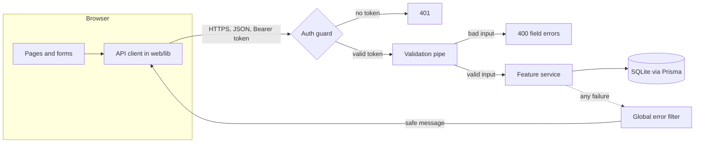
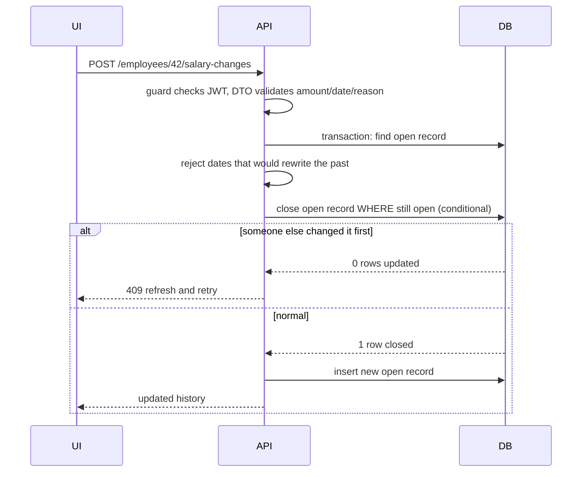

# Architecture walkthrough

A plain language tour of the whole app: what each technology does, why it
was chosen, and how a request travels end to end. Read this before the
interview; every claim here matches the code.

## The technologies, and why each is here

| Piece | Technology | Why |
| --- | --- | --- |
| API framework | NestJS (Node + TypeScript) | Structured modules, dependency injection, decorators for validation and guards. Matches the role's stack and keeps a growing API organized. |
| ORM | Prisma | Type safe database access, migrations as code, and a one line switch from SQLite to Postgres later. |
| Database | SQLite | Zero infrastructure for a reviewer to run. A file is the whole database. Limits and the Postgres path are in docs/tradeoffs.md. |
| UI framework | Next.js (React) | The role's UI stack; file based routing, server and client components. |
| Styling | Tailwind CSS | Utility classes keep the UI consistent without a separate stylesheet architecture. |
| Charts | Recharts | React native charting for the dashboard. |
| Auth | JWT + bcrypt | Passwords are never stored, only bcrypt hashes; the API issues a signed token (12h) that the UI sends on every request. |
| Tests | Jest + supertest | Fast unit tests for logic, integration tests against a throwaway SQLite file, and HTTP level tests for auth and error behavior. |

## The big picture

Everything except `/health` and `/auth/login` passes the auth guard. Every
body passes the validation pipe. Every error passes the global filter. Those
three "everything passes through" rules are the backbone of the app's
security story.

## Flow 1: signing in

1. The HR manager submits email + password on `/login`.
2. `POST /auth/login` (public) looks up the user and runs `bcrypt.compare`.
   Unknown emails get a dummy comparison too, so response time does not
   reveal which accounts exist. Wrong password and unknown email return the
   same generic 401.
3. On success the API returns a JWT signed with `JWT_SECRET`.
4. The UI stores it in localStorage; the API client attaches it as a Bearer
   header on every later request. Expired or forged tokens get a 401 and the
   UI returns to `/login`.

## Flow 2: searching 10,000 employees

1. The directory page debounces typing (300ms), then calls
   `GET /employees?search=...&department=...&page=1&pageSize=25`.
2. The query DTO validates and caps `pageSize` at 100 - nobody can ask for
   the whole table at once.
3. Prisma runs a `WHERE` over indexed columns with `LIMIT/OFFSET`, plus a
   separate `COUNT`, in one transaction. Each row's current salary comes
   from one filtered include (`effectiveTo IS NULL`), so there is no N+1.
4. The table renders 25 rows with total count and pages.

## Flow 3: recording a raise (the most important flow)

History is never overwritten: the old record's `effectiveTo` closes the day
before the new one starts. The conditional update is what makes two
simultaneous raises safe - the second one finds zero rows still open and
rolls back with a 409. There is a test that proves this.

## Flow 4: the dashboard ("how does the org pay people")

Each card and chart is one aggregated SQL query, not rows loaded into
memory: totals and averages per department or country are `GROUP BY` queries
that join the FX table to normalize to USD. Median and distribution are the
honest exception: they load the ~10k current salaries (under 1 MB) because
ordering is unavoidable; docs/performance.md says what changes at 100k.

Counts mean: headcount = everyone; on payroll = ACTIVE + ON_LEAVE (inactive
people are excluded from pay analytics); that is why on payroll is slightly
higher than active.

## Where things can fail, and what the user sees

- Bad input: 400 with field level messages from the validation pipe.
- Malformed JSON: 400 "Malformed request body".
- Duplicate email: 409 "already in use".
- Unknown record: 404. Unknown route: 404.
- Concurrent salary changes: one wins, the other gets 409.
- Anything unexpected: 500 "Internal server error" for the client, full
  detail in the server log. Stack traces and Prisma internals never leave
  the server.

## What is deliberately not here

SSO and multiple roles (one persona), payroll execution, live FX rates,
multi-tenancy, mobile native. Each exclusion and its reasoning is in
docs/requirements.md and docs/tradeoffs.md - expect interview questions
there, because exclusions are where product thinking shows.

## Honest limits

Tested with the brief's target: 10,000 employees, 38,804 salary records.
Not load tested under concurrent traffic. SQLite serves one writer at a
time, which is fine for an HR team tool and the documented reason the
Postgres path exists. The free tier deployment (docs/deployment.md) resets
data on idle and is meant for review, not real HR data.
